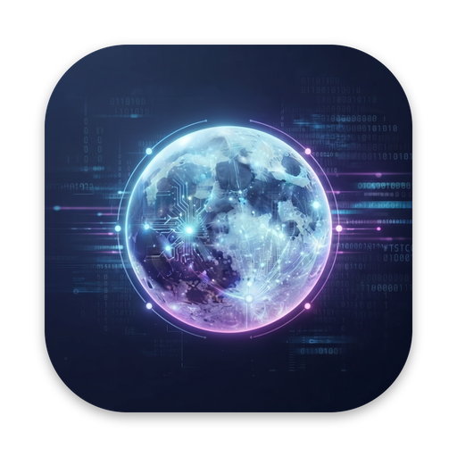
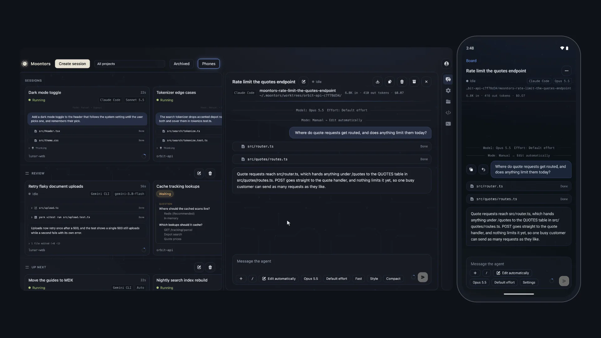

  

<h1 align="center">Moontors</h1>

  <strong>Many agents. Every project. One board.</strong> 
  Run Claude Code, Codex and Gemini CLI side by side, across all your projects, on macOS, Windows and Linux. A free agentic development environment (ADE), built around your agents rather than your files, that keeps all of them in view and working in the background.

  
  
  

  <a href="https://github.com/moontors/moontors/releases/latest"><strong>Download</strong></a> ·
  <a href="https://github.com/moontors/moontors/issues/new/choose">Report a bug</a> ·
  <a href="https://github.com/moontors/moontors/issues/new/choose">Request a feature</a>

  <a href="https://moontors.com"><picture><source type="image/avif" srcset=".github/assets/hero.avif"></picture></a>

---

Moontors is an **ADE, an agentic development environment**: a desktop app for macOS, Windows and
Linux where you direct AI coding agents instead of typing every line yourself. It runs
**Claude Code**, **Codex** and **Gemini CLI** side by side. Every session sits on one board,
streaming its work live, so you can follow them all, answer the one that needs you, and review what
each one changed without leaving the app. A background service runs the agents, so they keep
working when the window is closed.

> **Early preview.** Moontors is at 0.x. It's ready for daily use, but expect rough edges, and
> please [tell us](https://github.com/moontors/moontors/issues/new/choose) when you find one.

## Features

- **Every session on one board.** Claude Code, Codex and Gemini CLI sessions side by side, each card
  showing its transcript live. Sort them into your own sections, and filter by project.
- **Talk to agents as you would to people.** Reply to any row of a transcript, send while the agent
  works, have the agent rephrase your draft first, and let your sessions message each other: a
  Claude Code session can hand work to a Codex session and hear back.
- **Keeps working without you.** Sessions run in a background service, not in the window, so they
  carry on when you close it. While Moontors is open, a desktop notification tells you when a
  session needs you or runs into trouble.
- **Your sessions on your phone.** The [Android app](https://play.google.com/store/apps/details?id=com.moontors.mobile) or the [iPhone app](https://apps.apple.com/app/id6824488067) pairs with Moontors on your computer
  once, by scanning the code it shows or typing it, then shows the board and every session: follow
  them, answer their questions and permission requests, and reply, away from your desk. It reaches
  your computer on the same network or through Tailscale, with nothing in between.
- **You decide what agents may do.** Permission modes from Manual to Bypass, changed as you go,
  with Allow and Deny right in the transcript.
- **A worktree per task.** A session can work in its own git worktree, on a new branch if you name
  one, with the files it needs copied in, and archiving it asks before anything is removed.
- **The Git view.** Each session's repository as a graph, every branch in a lane of its own and each
  agent's commit the moment it lands. Find a commit as you type, and see which commits git verified
  as signed. Check out, branch, merge, rebase, cherry-pick, tag, stash, fetch, pull and push from
  right-click menus.
- **Every file at hand.** Files opens the session's folder as a tree beside an editor. Go to File
  (Cmd+P, or Ctrl+P) finds a file by a few letters of its name, Find in Files searches and replaces
  across the folder, right-click menus make, move, copy, rename and delete files, and images, PDFs
  and more preview in their tab.
- **Review as you go.** The session's changes hunk by hunk in the Git view, to stage, discard and
  commit, edits in the transcript coloured as the editor colours code, and a file editor that never
  overwrites the agent's work, or yours, while the agent keeps working.
- **The agents' own commands.** Each agent's slash commands work in Moontors, apart from those
  that only make sense in a terminal, along with `/rewind`, `/compact`, side questions, subtasks,
  forks, `/export` and `@` file mentions.
- **Your setup, untouched.** Your agents' settings, MCP servers, skills and commands reach
  Moontors' sessions, and Moontors never writes your own configuration files.
- **Usage at a glance.** A context meter on every card, token usage, and your account's limits.
- **Private by design.** No Moontors account, no telemetry, no tracking. Moontors keeps your
  sessions on your computer, and each agent talks to its own vendor, to the services and MCP servers you
  set it up with, and to any site its own tools reach, just as it would in your terminal.

## Download

Get the newest version from the **[latest release](https://github.com/moontors/moontors/releases/latest)**.

| Platform | Download                                                                 | Requires                    |
| -------- | ------------------------------------------------------------------------ | --------------------------- |
| macOS    | the `.dmg` ending in `-arm64` for Apple silicon, the other one for Intel | macOS 13 Ventura or later   |
| Windows  | `Moontors-Setup-<version>.exe`                                           | Windows 10 or later, x64    |
| Linux    | `Moontors-x86_64.AppImage`, or the `.deb` for Ubuntu and Debian          | x86-64 Linux with a desktop |

Moontors downloads and verifies each agent's own program the first time you use it. You'll also
want [git](https://git-scm.com) 2.23 or later: Moontors uses it for the Git view and worktree
sessions, and on Windows Claude Code needs [Git for Windows](https://gitforwindows.org).

On your phone, get **[Moontors for Android](https://play.google.com/store/apps/details?id=com.moontors.mobile)** from Google Play or **[Moontors for iPhone](https://apps.apple.com/app/id6824488067)** from the App Store, and pair it from **Phones**
in Moontors on your computer.

### First launch

- **macOS:** open the `.dmg` and drag Moontors to Applications.
- **Windows:** run the installer. Until Moontors' Windows builds are signed, SmartScreen may warn
  about an unrecognized app: choose **More info**, then **Run anyway**. Windows 11's Smart App
  Control, when it's on, blocks unsigned apps outright.
- **Linux:** make the AppImage executable (`chmod +x Moontors-x86_64.AppImage`) and run it, or
  install the `.deb` with `sudo apt install ./<file>.deb`.
  - The AppImage needs FUSE. Without it, start it with `--appimage-extract-and-run`.
  - On systems that block the user namespaces Chromium's sandbox needs, such as Ubuntu 24.04, the
    AppImage runs with Chromium's sandbox off, and says so once. The `.deb` keeps the sandbox on.

## Getting started

1. **Sign in to a provider:** with your Claude or ChatGPT account in the browser, or with an API
   key, which Moontors keeps in your system's keychain. Gemini CLI takes a Gemini API key, as
   Google doesn't let personal accounts sign in to it through the browser.
2. **Create a session:** pick a project folder, choose an agent and a model, and give it a task.
3. **Follow along on the board.** Open any session to read its full transcript, answer its
   questions, or review its changes.
4. **Take it with you, if you like:** choose **Phones**, then **Pair a phone**, and pair the
   [Android app](https://play.google.com/store/apps/details?id=com.moontors.mobile) or the [iPhone app](https://apps.apple.com/app/id6824488067) by the code your computer shows.

## Updates

Moontors checks for a new version when it starts and every 4 hours, and downloads it in the
background. When it's ready, Moontors offers **Restart to update**. Choose it when it suits you:
Moontors waits for running work to finish, installs the update and reopens. It says first if that
ends a running terminal, and asks before it discards unsaved edits. To look at once, choose
**Check for Updates…**: in the Moontors menu on macOS, and in Help on Windows and Linux.

- The AppImage updates itself: it deletes the old file, then moves the new one into its place, so if
  that move fails (a full disk, or the machine stopping in between), download it again.
- The `.deb` asks for your password to update. It isn't signed, so only the download's checksum is
  checked, and if a package it needs is missing, apt may add or remove packages to fix that.

## Questions

**What is an agentic development environment (ADE)?**
It's where you work with AI coding agents rather than only an editor. You start agents on tasks,
follow their progress, answer their questions and permission requests, and review their changes.
Moontors does that for several agents at once, from different vendors, in one window.

**Does Moontors replace Claude Code, Codex or Gemini CLI?**
No. Moontors runs each vendor's own official agent, so you get the same agent, signed in with your
own account and using your own settings, MCP servers and skills, with a desktop app around it.

**Is Moontors free?**
Yes. Moontors is free to use, with no account. You use your own plan or API key with each agent's
vendor.

**What do I need to use it?**
An account with the agent's vendor: a Claude subscription or an Anthropic API key for Claude Code,
a ChatGPT plan or an OpenAI API key for Codex, and a Gemini API key for Gemini CLI. Moontors itself
is free.

**Can several agents work on the same repository?**
Yes. Each session can work in its own git worktree, on a branch of its own if you name one, so
agents don't step on each other's changes, and you review and merge each branch as you would
anyone's.

**Is there a phone app?**
Yes, for Android, on [Google Play](https://play.google.com/store/apps/details?id=com.moontors.mobile), and for the iPhone, on the [App Store](https://apps.apple.com/app/id6824488067). It pairs with Moontors on your computer and works on
the same sessions: the board, the transcripts, answering questions and permission requests, and
replying.

**Does Moontors see my code?**
No. There are no Moontors servers. Each agent talks to its own vendor, to the services and MCP
servers you set it up with, and to any site its own tools reach, as it would in your terminal, and
Moontors keeps your sessions on your computer.

## Feedback and support

- **Found a bug?** [Open an issue](https://github.com/moontors/moontors/issues/new/choose) and
  include the build line from Moontors' **About** window or `/status`. It names your exact version.
- **Have an idea?** [Request a feature](https://github.com/moontors/moontors/issues/new/choose).
- **Anything else:** [hello@moontors.com](mailto:hello@moontors.com).

## Privacy and terms

Moontors has no account, telemetry or tracking. The [Privacy Policy](PRIVACY.md) says exactly what
it keeps, where, and what reaches the internet. Use of Moontors is governed by the
[Terms of Use](TERMS.md). The open-source software Moontors includes, and its licenses, are listed
in the [third-party notices](https://moontors.com/policies/notices/).

---

© 2026 Moontors. All rights reserved. Moontors is an independent agentic development
environment, not affiliated with or endorsed by Anthropic, OpenAI or Google. Claude Code, Codex and
Gemini CLI are trademarks of their respective owners.
